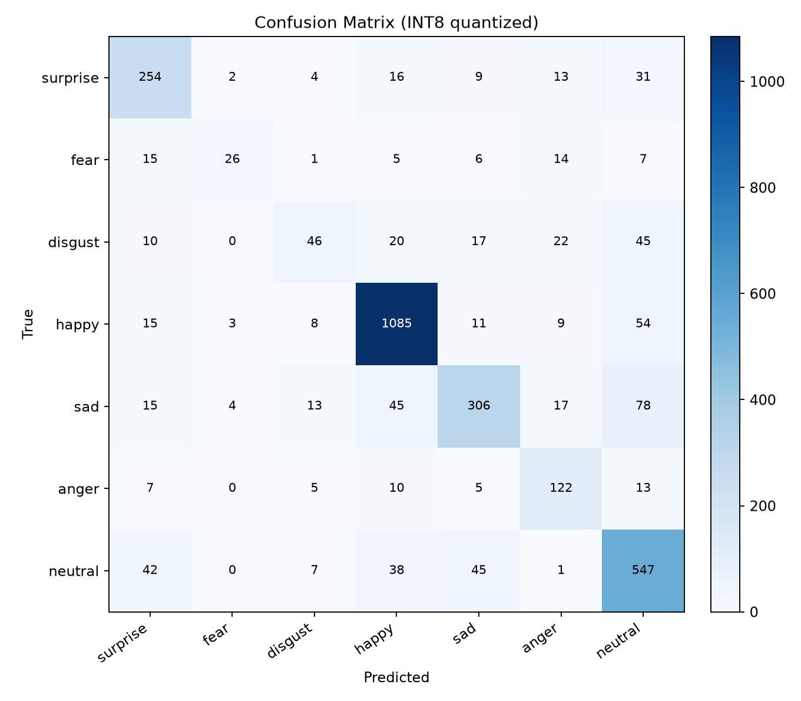

# esp32-emotion — ESP32-S3 上的 7 类表情识别

117 KB 的 INT8 模型：输入 48×48 灰度人脸，输出 7 类表情概率。
附带训练、量化、C 头文件导出的完整流程。

模型代号 `pupil`，所以产物文件名是 `pupil.tflite` / `pupil.h`。

An INT8 7-class facial-expression classifier (48×48 grayscale, 117 KB) for ESP32-S3.

## 效果

测试集是 RAF-DB 官方划分的 3,068 张，只在最后评估一次。

| 模型 | 大小 | 7 类准确率 | 业务分组准确率 |
|---|---|---|---|
| FP32（Keras） | 1.3 MB | 77.38% | — |
| **INT8（TFLite，发布版）** | **117.7 KB** | **77.77%** | **79.11%** |

量化后准确率未下降（FP32 77.38% → INT8 77.77%，差异在训练随机波动范围内）。

| 业务指标（INT8） | 数值 |
|---|---|
| 轻度负向组召回 | 58.85% |
| 轻度负向 → neutral 泄漏 | 18.26% |
| neutral → 轻度负向误报 | 7.65% |
| happy → anger 泄漏 | 0.76% |



训练曲线见 `docs/training_curves.png`。

## 方法

**输入 48×48 单通道灰度。** 选 48×48 是因为上游人脸检测流程原生输出这个尺寸，改分辨率要连固件一起改。试过 96×96，在 ESP32-S3 上更臃肿，精度也没跟着涨。

**结构**：4 个 conv 块（16/32/64/128）+ 平均池化 + GlobalAveragePooling + 两层全连接，106,583 参数，约 8.3 M MACs。没用深度可分离卷积和注意力模块——参数量本来就小，瓶颈在输入分辨率，不在容量。

**损失**：label smoothing 打底，叠加三条业务约束：

1. fear / disgust / sad 同属“轻度负向”，允许彼此混淆（组内软标签 0.80 / 0.09）；
2. happy 被判成 anger，代价额外放大 0.35；
3. neutral 被判成任何有表情的类别，代价放大 0.08。

实现在 `emotion/losses.py`，每个系数的来历都写在注释里。

## 复现
训练存在随机性，重跑结果会有 ±1 个点波动；本文数字来自一次具体运行。

需要 [uv](https://docs.astral.sh/uv/)。

```bash
uv sync

uv run python -m emotion.train               # 训练，CPU 约 20 分钟
uv run python -m emotion.quantize            # INT8 全量化
uv run python -m emotion.evaluate            # 测试集评估 + 混淆矩阵
uv run python scripts/export_c_header.py     # 生成 firmware/pupil.h
```

产物：

```
models/pupil.keras      FP32 模型
models/pupil.tflite     INT8 模型（发布版）
firmware/pupil.h        C 头文件
docs/*.png              训练曲线与混淆矩阵
```

## 数据

[RAF-DB](https://www.whdeng.cn/RAF/model1.html) 基础情绪子集，15,339 张，官方划分 12,271 训练 / 3,068 测试。

数据集不进仓库，自行申请后按下面的结构放：

```
data/
├── train/
│   ├── 0/   0 = surprise
│   ├── 1/   1 = fear
│   ├── 2/   2 = disgust
│   ├── 3/   3 = happy
│   ├── 4/   4 = sad
│   ├── 5/   5 = anger
│   └── 6/   6 = neutral
└── test/
    └── （同上）
```

目录顺序必须和 `emotion/config.py` 的 `CLASS_NAMES` 对齐。**顺序错位不会报错**，但损失函数里的业务惩罚会打到错误的类别上，训练结果照样能出，只是全错。

## 部署到 ESP32-S3

`firmware/pupil.h` 是 `xxd -i` 格式，数组名固定：

```c
const unsigned int emotion_model_quant_tflite_len = 120496;
const unsigned char emotion_model_quant_tflite[] = { ... };
```

覆盖到固件的 `components/emotion_recognition/pupil.h` 即可，C++ 侧不用改。输入 uint8、输出 float32，和原模型接口一致。

## 评估协议

- 验证集从 `data/train` 切 15%（1,840 张），用于早停和学习率调度。
- 测试集 3,068 张不参与任何决策，只在 `emotion.evaluate` 里跑一次。
- 量化校准样本从训练集每类抽 150 张。

上面那些数字没有选择偏差。早期版本拿测试集当验证集用，报告值带着模型选择的乐观偏差，和现在这套不能直接对比。

## 已知局限

- 48×48 灰度丢细节，少数类召回很低：**fear 35.1%、disgust 28.7%**，happy 则有 91.6%（训练集 fear 281 张、disgust 717 张、happy 4,772 张）。组召回 58.85% 主要被这两类拖累。
- 训练数据以摆拍为主，强侧光、遮挡、戴眼镜会退化。
- 7 类输出不等于连续情绪维度，端侧建议按业务做分组决策。

## License

MIT，见 [LICENSE](LICENSE)。
